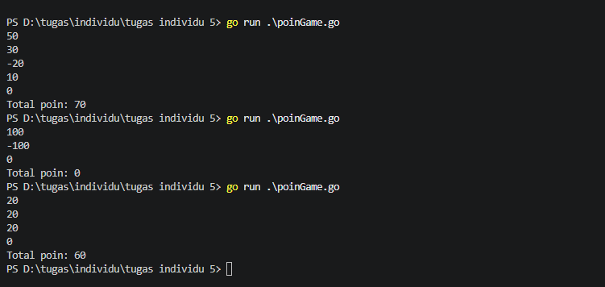
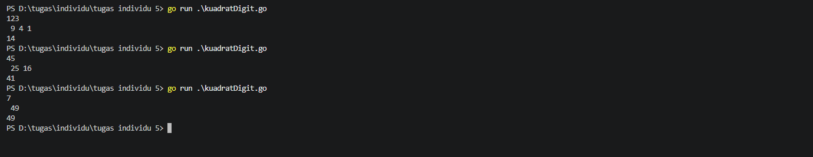
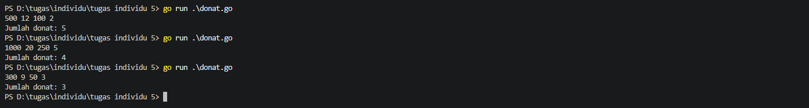
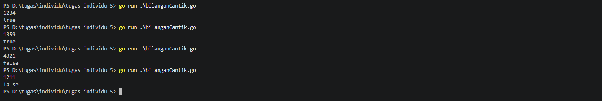
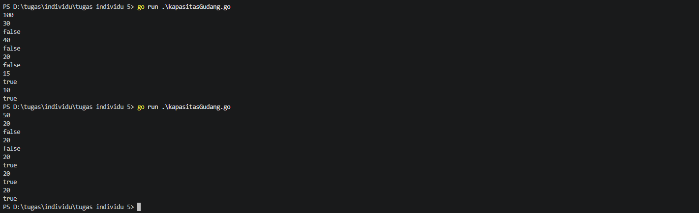

# <h1 align="center"> Tugas Individu: Perulangan (For Loop) </h>
## 1. Soal Poin Game
```go
package main
import "fmt"

func main() {
	var poin int
	totalPoin := 0

	for {
		fmt.Scan(&poin)
		if poin == 0 {
			break
		}
		totalPoin += poin
	}
	fmt.Printf("Total poin: %d", totalPoin)
}
```
#### Output

## 2. Soal Kuadrat Digit
```go
package main
import "fmt"

func main() {
	var x int
	fmt.Scan(&x)

	total := 0
	

	for x > 0 {
		digit := x % 10
		kuadrat := digit * digit

		fmt.Printf(" %d", kuadrat)
	total += kuadrat
	x /= 10
	}
	fmt.Println()
	fmt.Println(total)
}
```
#### Output

## 3. Soal Donat
```go
package main
import "fmt"

func main() {
	var n, m, x, y int
	fmt.Scan(&n, &m, &x, &y)
	jumlahDonat := 0

	for n >= x && m >= y {
		n -= x
		m -= y
		jumlahDonat++
	}
	fmt.Println("Jumlah donat:", jumlahDonat)
}
```
#### Output

## 4. Soal Bilangan Cantik
```go
package main
import "fmt"

func main() {
	var x int
	var bilanganCantik bool
	fmt.Scan(&x)

	for x >= 10 {
		digitKanan := x % 10
		x /= 10
		digitKiri := x % 10

		if digitKiri > digitKanan {
			bilanganCantik = false
			break
		} else {
			bilanganCantik = true
		}
	}
	fmt.Println(bilanganCantik)
}
```
#### Output

## 5. Soal Kapasitas Gudang
```go
package main
import "fmt"

func main() {
	var K, V int
	fmt.Scan(&K)
	totalBarang := 0

	for i := 0; i < 5; i++ {
		fmt.Scan(&V)
		totalBarang += V

		fmt.Println(totalBarang >= K)
	}
} 
```
#### Output
