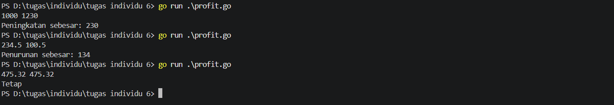
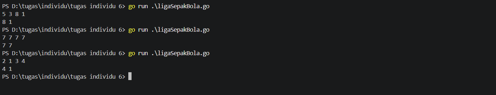
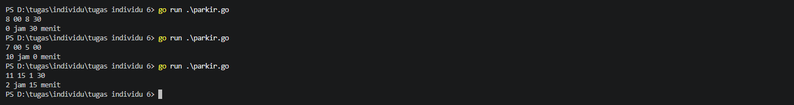
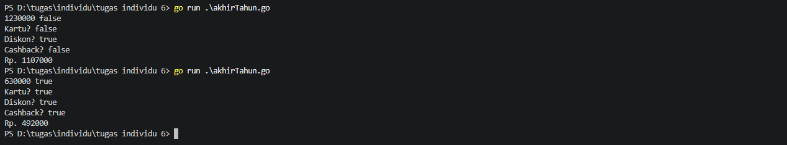
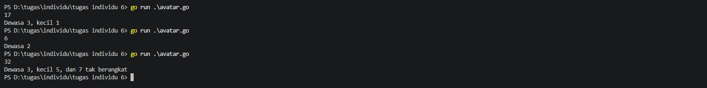

# <h1 align="center"> Tugas Individu: Percabangan </h>
## 1. Soal Profit
```go
package main
import "fmt"

func main() {
	var bulanIni, bulanSebelum, selisih float64
	fmt.Scan(&bulanSebelum, &bulanIni)

	if bulanIni > bulanSebelum {
		selisih = bulanIni - bulanSebelum
		fmt.Println("Peningkatan sebesar:", selisih)
	} else if bulanIni < bulanSebelum {
		selisih = bulanSebelum - bulanIni
		fmt.Println("Penurunan sebesar:", selisih)
	} else if bulanIni == bulanSebelum {
		fmt.Println("Tetap")
	}
}
```

## 2. Soal Liga Sepak Bola
```go
package main
import "fmt"

func main() {
	var gol1, gol2, gol3, gol4 int
	fmt.Scan(&gol1, &gol2, &gol3, &gol4)
	golBesar := gol1
	golKecil := gol1

	if gol2 > golBesar {
		golBesar = gol2
	}
	if gol3 > golBesar {
		golBesar = gol3
	}
	if gol4 > golBesar {
		golBesar = gol4
	}

	if gol2 < golKecil {
		golKecil = gol2
	}
	if gol3 < golKecil {
		golKecil = gol3
	}
	if gol4 < golKecil {
		golKecil = gol4
	}

	fmt.Print(golBesar, golKecil)
}
```

## 3. Soal Parkir
```go
package main
import "fmt"

func main() {
	var h1, m1, h2, m2 int
	fmt.Scan(&h1, &m1, &h2, &m2)

	if h1 < 7 {
		h1 += 12
	}
	if h2 < 7 {
		h2 += 12
	}

	t1 := (h1 * 60) + m1
	t2 := (h2 * 60) + m2
	selisih := t2 - t1

	hh := selisih / 60
	mm := selisih % 60

	fmt.Printf("%d jam %d menit", hh, mm)
}
```

## 4. Soal Akhir Tahun
```go
package main
import "fmt"

func main() {
	var kartu, diskon, cashback, dapatKartu bool
	var totalBelanja, totalDiskon float64
	dapatKartu = false
	diskon = false
	cashback = false
	fmt.Scan(&totalBelanja)
	fmt.Scan(&kartu)
	
	if totalBelanja >= 100000 {
		diskon = true
	}
	if kartu == true && diskon == true {
		dapatKartu = true
	}
	if totalBelanja >= 200000 && dapatKartu == true {
		cashback = true
	}

	if diskon == true {
		totalDiskon = totalBelanja * 0.10
		totalBelanja -= totalDiskon
	}
	if cashback == true {
		totalBelanja -= 75000
	}


	fmt.Println("Kartu?", dapatKartu)
	fmt.Println("Diskon?", diskon)
	fmt.Println("Cashback?", cashback)
	fmt.Printf("Rp. %.0f\n", totalBelanja)
}
```

## 5. Soal Avatar
```go
package main

import "fmt"

func main() {
	var p int
	fmt.Scan(&p)
	appaDewasa := 3
	appaKecil := 5

	dewasa := (p + 4) / 5
	if dewasa > appaDewasa {
		dewasa = appaDewasa
	}
	sisaOrang := p - (dewasa * 5)

	kecil := 0
	if sisaOrang > 0 {
		kecil = (sisaOrang + 1) / 2
		if kecil > appaKecil {
			kecil = appaKecil
		}
	}
	sisaOrang -= (kecil * 2)

	takBerangkat := 0
	if sisaOrang > 0 {
		takBerangkat = sisaOrang
	}

	switch {
	case dewasa > 0 && kecil > 0 && takBerangkat > 0:
		fmt.Printf("Dewasa %d, kecil %d, dan %d tak berangkat", dewasa, kecil, takBerangkat)
	case dewasa > 0 && kecil > 0:
		fmt.Printf("Dewasa %d, kecil %d", dewasa, kecil)
	case dewasa > 0 && takBerangkat > 0:
		fmt.Printf("Dewasa %d, dan %d tak berangkat", dewasa, takBerangkat)
	case dewasa > 0:
		fmt.Printf("Dewasa %d", dewasa)
	case kecil > 0 && takBerangkat > 0:
		fmt.Printf("Kecil %d, dan %d tak berangkat", kecil, takBerangkat)
	case kecil > 0:
		fmt.Printf("Kecil %d", kecil)
	case takBerangkat > 0:
		fmt.Printf("%d tak berangkat", takBerangkat)
	}
}
```
