# <h1 align="center"> Latihan Soal 2: Kombinasi Perulangan dan Percabangan </h>
## Soal 1a. Faktor Persekutuan
```go
package main
import "fmt"

func main() {
	var n, m int
	fmt.Scan(&n, &m)
	pertama := true
	limit := n

	if m < n {
		limit = m
	}

	for i := 1; i <= limit; i++ {
		if n % i == 0 && m % i == 0 {
			if !pertama {
				fmt.Print(", ")
			}
			fmt.Print(i)
			pertama = false
		}
	}
	fmt.Println()
}
```
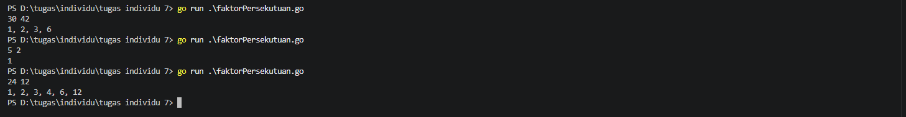
## Soal 1b. Faktor Persekutuan Terbesar
```go
package main
import "fmt"

func main() {
	var n, m int
	fmt.Scan(&n, &m)
	
	for m != 0 {
		n, m = m, n % m
	}
	fmt.Println(n)
}
```
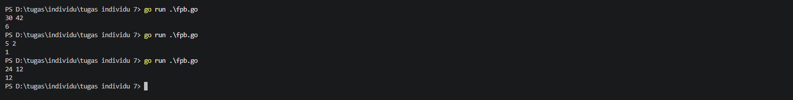
## Soal 2. Kelipatan Persekutuan Terkecil
```go
package main
import "fmt"

func main() {
	var n, m int
	fmt.Scan(&n, &m)
	a, b := n, m

	for b != 0 {
		a, b = b, a % b
	}
	kpk := (n * m) / a
	fmt.Println(kpk)
}
```
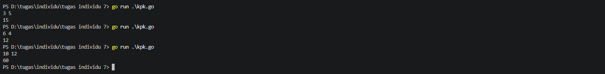
## Soal 3a. Museum 1
```go
package main
import "fmt"

func main() {
	var n int
	total := 0
	jumlah := 0
	kenaikan := 0
	s := -1
	
	for {
		fmt.Scan(&n)

		if n < 0 || n > 200 {
			break
		}
		if s != -1 && n > s {
			kenaikan++
		}
		total += n
		jumlah++
		s = n
	}
	var rataRata float64
	if jumlah > 0 {
		rataRata = float64(total) / float64(jumlah)
	} else {
		rataRata = 0
	}
	if rataRata == float64(int(rataRata)) {
		fmt.Printf("%d %.0f\n", kenaikan, rataRata)
	} else {
		fmt.Printf("%d %.2f\n", kenaikan, rataRata)
	}
}
```
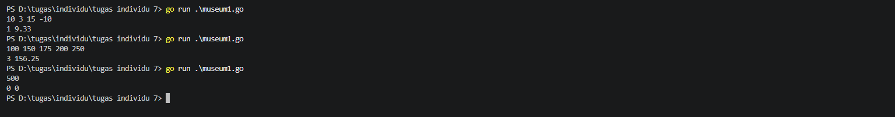
## Soal 3b. Museum 2
```go
package main
import "fmt"

func main() {
	total := 0

	for i := 1; i <= 5; i++ {
		var n int
		for {
			fmt.Printf("Hari %d: ", i)
			fmt.Scan(&n)

			if n >= 0 && n <= 200 {
				break
			}
		}
		total += n
	}
	fmt.Printf("Jumlah pengunjung: %d orang \n", total)
}
```
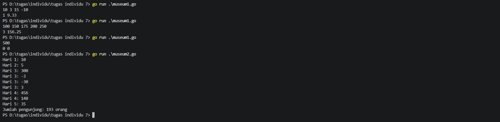
## Soal 4. Balap Mobil Mini
```go
package main
import "fmt"

func main() {
	var input string
	A, B := 0, 0
	finishA, finishB := 0, 0
	pemenang := ""

	for i := 1; i <= 10; i++ {
		fmt.Scan(&input)

		if input == "A" {
			A++
			finishA++
			if finishA == 4 && pemenang == "" {
				pemenang = "A"
			}
		} else if input == "B" {
			B++
			finishB++
			if finishB == 4 && pemenang == "" {
				pemenang = "B"
			}
		}
	}
	if A != 5 || B != 5 {
		fmt.Println("tidak valid")
	} else {
		fmt.Println(pemenang)
	}
}
```
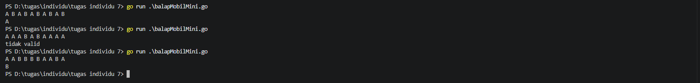
## Soal 5. Digit Terurut
```go
package main
import "fmt"

func main() {
	var n int
	fmt.Scan(&n)

	digitTerakhir := n % 10
	n = n / 10
	ascending := true
	descending := true

	for n > 0 {
		digitS := n % 10
		if digitS > digitTerakhir {
			ascending = false
		} else if digitS < digitTerakhir {
			descending = false
		}
		digitTerakhir = digitS
		n = n / 10
	}

	if ascending == true {
		fmt.Println("Ascending")
	} else if descending == true {
		fmt.Println("Descending")
	} else {
		fmt.Println("Tidak terurut")
	}
}
```
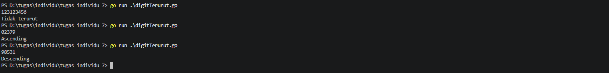
## Soal 6a. My Tel-U 1
```go
package main
import "fmt"

func main() {
	var poin int
	fmt.Scan(&poin)

	switch {
	case poin >= 200:
		fmt.Println("Gold user")
	case poin >= 100 && poin < 200:
		fmt.Println("Platinum user")
	case poin >= 50 && poin <= 99:
		fmt.Println("Silver user")
	default:
		fmt.Println("Poin tidak valid")
	}
}
```
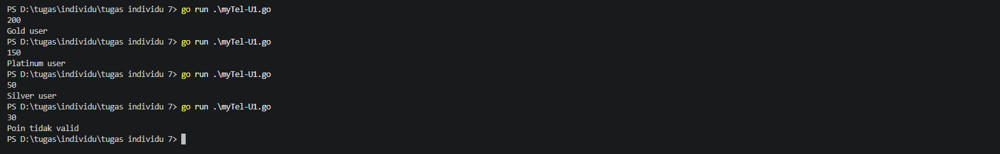
## Soal 6b. My Tel-U 2
```go
package main
import "fmt"

func main() {
	var poin int

	for {
		fmt.Scan(&poin)
		if poin >= 50 {
			break
		}
	}
	
	switch {
	case poin >= 200:
		fmt.Println("Gold user")
	case poin >= 100 && poin < 200:
		fmt.Println("Platinum user")
	case poin >= 50 && poin <= 99:
		fmt.Println("Silver user")
	default:
		fmt.Println("Poin tidak valid")
	}
}
```
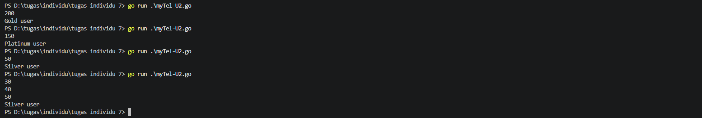
## Soal 6c. My Tel-U 3
```go
package main
import "fmt"

func main() {
	var n int
	fmt.Scan(&n)
	gold, platinum, silver := 0, 0, 0

	for i := 0; i < n; i++ {
		var poin int

		for {
			fmt.Scan(&poin)
			if poin >= 50 {
				break
			}
		}

		switch {
		case poin >= 200:
			gold++
		case poin >= 100 && poin < 200:
			platinum++
		case poin >= 50 && poin <= 99:
			silver++
		}
	}
	fmt.Println("Gold user:", gold)
	fmt.Println("Platinum user:", platinum)
	fmt.Println("Silver user:", silver)
}
```
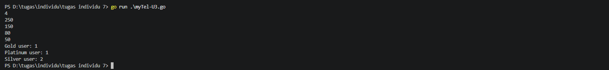
## Soal 6d. My Tel-U 4
```go
package main
import "fmt"

func main() {
	gold, platinum, silver := 0, 0, 0
	totalPoin := 0

	for totalPoin < 500 {
		var poin int

		for {
			fmt.Scan(&poin)
			if poin >= 50 {
				break
			}
		}
		totalPoin += poin
		
		switch {
		case poin >= 200:
			gold++
		case poin >= 100 && poin < 200:
			platinum++
		case poin >= 50 && poin <= 99:
			silver++
		}
	}
	fmt.Println("Gold user:", gold)
	fmt.Println("Platinum user:", platinum)
	fmt.Println("Silver user:", silver)
}
```
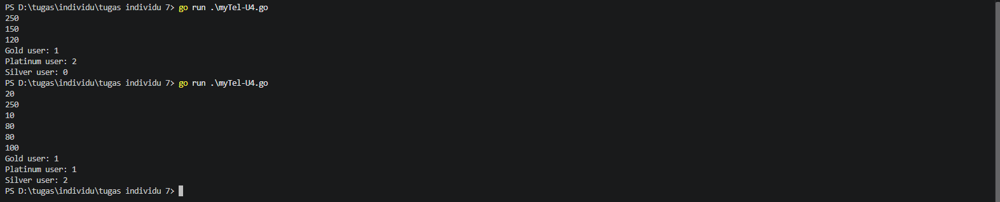
## Soal 6e. My Tel-U 5
```go
package main
import "fmt"

func main() {
	totalGold, totalPlatinum, totalSilver := 0, 0, 0
	gold, platinum, silver := 0, 0, 0
	totalPoin := 0

	for totalPoin < 500 {
		var poin int

		for {
			fmt.Scan(&poin)
			if poin >= 50 {
				break
			}
		}
		totalPoin += poin
		
		switch {
		case poin > 200:
			totalGold++
			gold += poin
		case poin >= 100 && poin < 200:
			totalPlatinum++
			platinum += poin
		case poin >= 50 && poin <= 99:
			totalSilver++
			silver += poin
		}
	}
	var rataRataGold, rataRataPlatinum, rataRataSilver float64

	if totalGold > 0 {
		rataRataGold = float64(gold) / float64(totalGold)
	}
	if totalPlatinum > 0 {
		rataRataPlatinum = float64(platinum) / float64(totalPlatinum)
	}
	if totalSilver > 0 {
		rataRataSilver = float64(silver) / float64(totalSilver)
	}
	fmt.Printf("%.2f %.2f %.2f\n", rataRataGold, rataRataPlatinum, rataRataSilver)
}
```
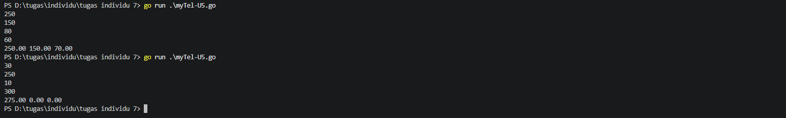
