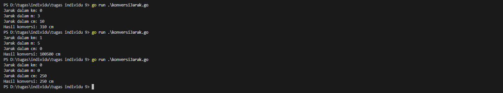
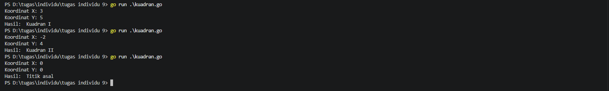
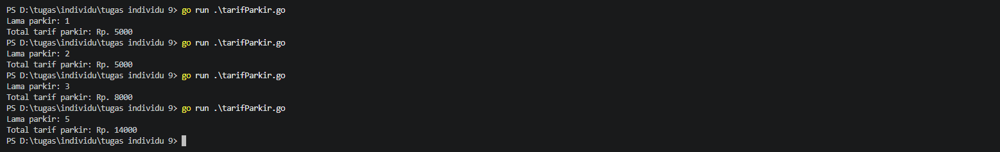
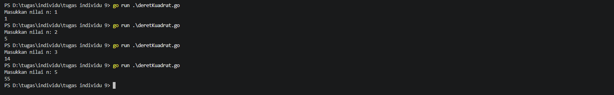
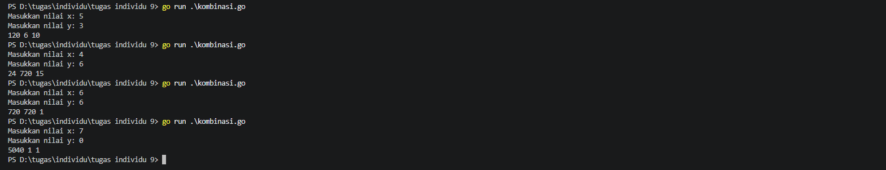

# <h1 align="center"> Tugas Individu: Function</h>
## 1. Soal Konversi Jarak
```go
package main
import "fmt"

func konversi(km, m, cm int) int {
	return (km * 100000) + (m * 100) + cm
}

func main() {
	var km, m, cm int
	fmt.Print("Jarak dalam km: ")
	fmt.Scan(&km)
	fmt.Print("Jarak dalam m: ")
	fmt.Scan(&m)
	fmt.Print("Jarak dalam cm: ")
	fmt.Scan(&cm)

	total := konversi(km, m, cm)
	fmt.Printf("Hasil konversi: %d cm", total)
}
```
#### Output

## 2. Soal Kuadran
```go
package main
import "fmt"

func kuadran(x, y int) string {
	switch {
	case x == 0 && y == 0:
		return "Titik asal"
	case x == 0:
		return "Titik pada sumbu Y"
	case y == 0:
		return "Titik pada sumbu X"
	case x > 0 && y > 0:
		return "Kuadran I"
	case x < 0 && y > 0:
		return "Kuadran II"
	case x < 0 && y < 0:
		return "Kuadran III"
	case x > 0 && y < 0:
		return "Kuadran IV"
	default:
		return "Tidak valid"
	}
}

func main() {
	var x, y int
	fmt.Print("Koordinat X: ")
	fmt.Scan(&x)
	fmt.Print("Koordinat Y: ")
	fmt.Scan(&y)

	hasil := kuadran(x, y)
	fmt.Println("Hasil: ", hasil)
}
```
#### Output

## 3. Soal Tarif Parkir
```go
package main
import "fmt"

func tarif(jam int) int {
	if jam <= 2 {
		return 5000
	}
	return 5000 + (jam - 2) * 3000
}

func main() {
	var lamaParkir int
	fmt.Print("Lama parkir: ")
	fmt.Scan(&lamaParkir)

	total := tarif(lamaParkir)
	fmt.Println("Total tarif parkir: Rp.", total)
}
```
#### Output

## 4. Soal Deret Kuadrat
```go
package main
import "fmt"

func deretKuadrat(n int) int {
	total := 0
	for i := 1; i <= n; i++ {
		total += i * i
	}
	return total
}

func main() {
	var n int
	fmt.Print("Masukkan nilai n: ")
	fmt.Scan(&n)

	hasil := deretKuadrat(n)
	fmt.Println(hasil)
}
```
#### Output

## 5. Soal Kombinasi
```go
package main
import "fmt"

func faktorial(n int) int {
	hasil := 1
	for i := 1; i <= n; i++ {
		hasil *= i
	}
	return hasil
}

func C(n, r int) int {
	return faktorial(n) / (faktorial(r) * faktorial(n - r))
}

func main() {
	var x, y, kombinasi int
	fmt.Print("Masukkan nilai x: ")
	fmt.Scan(&x)
	fmt.Print("Masukkan nilai y: ")
	fmt.Scan(&y)

	fx := faktorial(x)
	fy := faktorial(y)

	if x >= y {
		kombinasi = C(x, y)
	} else {
		kombinasi = C(y, x)
	}

	fmt.Println(fx, fy, kombinasi)
}
```
#### Output
